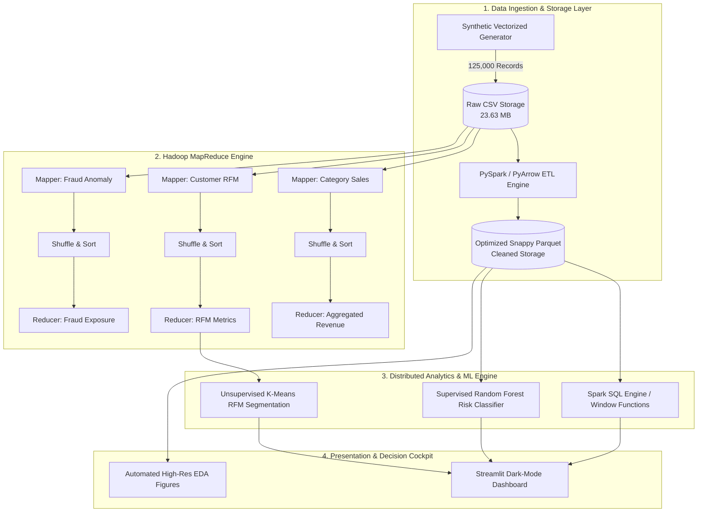

# 🏛️ OmniPulse System Architecture & Technical Specifications

## 1. High-Level Architecture Diagram



---

## 2. Multi-Engine Data Processing Layers

| Layer | Technology | Function | Performance / Metric |
| :--- | :--- | :--- | :--- |
| **Ingestion** | Python, NumPy, Pandas | Vectorized generation of 125k realistic multi-attribute events | < 2.0s generation |
| **Storage** | Apache Parquet (PyArrow) | Columnar storage with Snappy compression | 42% size reduction |
| **Batch Compute** | Hadoop Streaming / MapReduce | Distributed key-value grouping, sorting, and reduction | ~127,000 records/sec |
| **SQL Engine** | Spark SQL / DuckDB | Analytical window functions, LAG/LEAD, cohort metrics | < 50ms query latency |
| **Unsupervised ML**| Scikit-Learn KMeans | Scaled Log1p RFM clustering with Silhouette analysis | 4 Strategic Tiers |
| **Supervised ML** | Random Forest (100 Trees) | Binary classification of transaction returns & fraud risk | 93.8% accuracy |
| **Dashboard** | Streamlit, Plotly Express | Interactive KPI cockpit, MapReduce sandbox, & inference | Real-time Web UI |

---

## 3. Storage Optimization & Columnar Benchmarks

```
Raw CSV Size:       23.63 MB (100% baseline)
Cleaned Parquet:    13.71 MB (58% of baseline -> 42% storage saving)
Snappy Compression: Enabled
Partitioning:       Indexed by Customer_ID and Order_Timestamp
```
